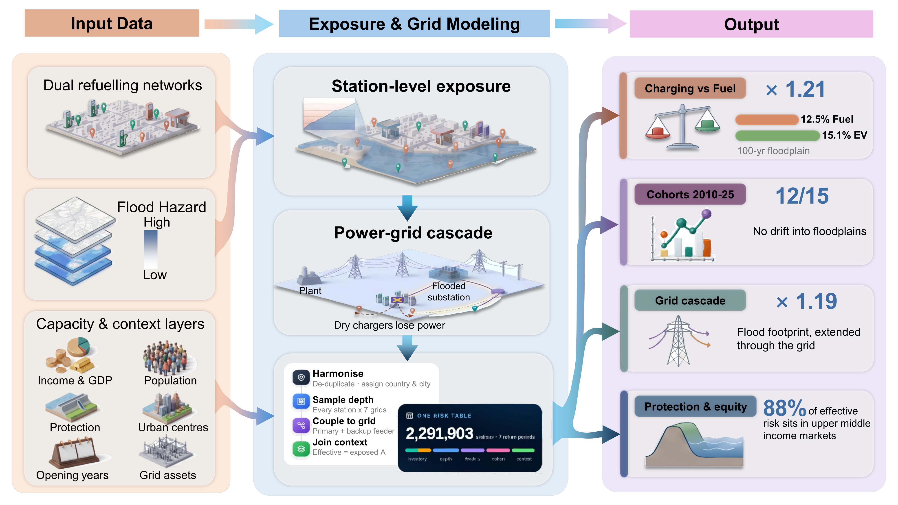

# Grid dependence amplifies flood impacts on the global electric vehicle charging network

Analysis code and figure data for the article by Zhi-Yong Long, Rui-Yi Yang, Long Jiang, Lu Chang and Huan-Feng Duan.

The study compares **947,602 public charging stations** with **1,344,301 fuel stations** across seven river-flood return periods. Under the 100-year event, 143,264 charging stations flood directly. Accounting for failures at their feeder substations raises expected outages to 170,142. The backup-feeder counterfactual reduces the amplification factor from 1.19 to 1.13.

[Redraw the composite figures](#redraw-the-composite-figures) · [Full reproduction](#reproduce-the-full-analysis-from-local-data) · [Figure guides](#figure-guides) · [Input sources](DATA_SOURCES.md) · [Data access](RESTRICTED_DATA_NOTICE.md) · [Citation](CITATION.cff)

## Getting started

From the repository root, create a Python 3.12 environment and install the pinned dependencies.

```bash
python -m venv .venv
```

Activate it with `.venv\Scripts\Activate.ps1` in PowerShell or `source .venv/bin/activate` in a POSIX shell.

```bash
python -m pip install -r requirements.txt
```

You can check the installed dependencies with `python check_environment.py`.

### Redraw the composite figures

To redraw the composites using the figure data already in this repository, run this command from the repository root.

```bash
python run_all.py figures
```

This mode reads the prepared figure tables directly. Each plotting script writes PNG, PDF, SVG and PDF-compatible Illustrator files beside the script. The runner records completed and skipped figures in `run_logs/`.

> [!NOTE]
> The public tables are sufficient for Figures 1, 2 and 5 and Supplementary Figures 1–3. Figures 3 and 4 also require local station-level map extracts. The runner skips those two composites until the required files are present. Supplementary Figure 4 is supplied as a static schematic.

### Reproduce the full analysis from local data

With the licensed station inventories and the other inputs listed in [Data sources](DATA_SOURCES.md) available locally, run the full pipeline from the repository root.

```bash
python run_all.py full
```

The runner executes the analyses and verification steps, reusing available checkpoints. It then prepares the city-map backgrounds, automatically calls `export_figure_source_data.py` to prepare the plotting tables and local city extracts, and draws the composites.

## Figure guides

| Figure | Scientific question | Inputs for the composite |
|:--|:--|:--|
| [1 · Infrastructure](figures/Figure1/README.md) | Where are charging and fuel stations concentrated? | Public tables |
| [2 · Direct flood exposure](figures/Figure2/README.md) | How much of the exposure gap persists within the same city? | Public tables |
| [3 · Opening cohorts](figures/Figure3/README.md) | Does floodplain share change with registration year? | Local city maps required for e–f |
| [4 · Grid-mediated outages](figures/Figure4/README.md) | How many dry charging sites lose power through their feeder? | Local feeder maps required for a–d |
| [5 · Protection and inequality](figures/Figure5/README.md) | Where does exposure remain after accounting for protection? | Public tables |
| [S1 · Input audits](figures/Supplementary_Figure1/README.md) | How well do the station, cohort and feeder records support the analysis? | Public tables |
| [S2 · Cascade robustness](figures/Supplementary_Figure2/README.md) | How sensitive are losses to fragility, backup supply and islanding? | Public tables |
| [S3 · Protection sensitivity](figures/Supplementary_Figure3/README.md) | How does effective exposure vary with event magnitude? | Public tables |
| [S4 · Study workflow](figures/Supplementary_Figure4/README.md) | How do the inventories, hazard model and protection layers fit together? | Static workflow schematic |



## Run the analysis

The [path settings](shared/paths.py) locate data on the researcher’s computer. The figure-data exporter uses the [Robinson projection and map extent](shared/plot_style.py) to aggregate station coordinates for Figure 1. The [composite plotting functions](figures/plot_style.py) style and export the published figures.

[Input sources](DATA_SOURCES.md) lists the inputs, local paths and source acknowledgements. Place individually obtained datasets under `source_data/`, or set `EVFR_SOURCE_ROOT` to a separate input directory. Inspect individual overrides and resolved paths with `python shared/paths.py`.

| Additional analysis modes | Inputs and outputs |
|:--|:--|
| `python run_all.py standard` | Recompute statistics and run checks using local station databases, intermediate tables and network checkpoints. |
| `python run_all.py standard fig3` | Run the cohort module against prepared local inputs. |
| `python run_all.py full --fresh` | Move existing checkpoints aside, then rerun the full analysis. |

### From station records to figure data

**To redraw the figures**, run `python run_all.py figures`. The plotting scripts read the prepared files under `figures/`. For example, each row of the [Figure 1 charging-density table](figures/Figure1/data/hexbin_charging_stations.csv) represents one map hexagon. The columns `x` and `y` locate its centre, and `stations` gives the number of charging sites inside it. Panel 1a colours the hexagon by that count. The individual site coordinates stay local.

**To rebuild those files**, run `python run_all.py full` with the [source datasets](DATA_SOURCES.md) available locally. The [station database scripts](analysis/stage0_station_database/) first assemble two inventories. The charging inventory uses AMap in mainland China and Google Places elsewhere. The fuel inventory uses Google Places. Both record one row per site.

| Analysis | Inputs used locally | What the analysis produces for the figure |
|:--|:--|:--|
| [Figure 1 · Station distribution](analysis/fig1_global_infrastructure/) | Charging and fuel inventories, IEA charging-point series | Station counts per hexagon and per country, plus a worldwide trend in the number of charging points. |
| [Figure 2 · Direct flooding](analysis/fig2_flood_exposure/) | Both inventories, river-flood depth maps and urban-centre boundaries | Flood depth at each site for seven return periods. These local depths supply the exposure shares plotted for each network, country and city. |
| [Figure 3 · Registration years](analysis/fig3_opening_year_cohorts/) | A separate registry with station registration years, flood maps and Figure 2 benchmarks | Floodplain shares by registration period and trends by country and city. The two city maps also use local extracts of dated stations. |
| [Figure 4 · Power outages](analysis/fig4_grid_cascade/) | Charging-site depths from Figure 2, substation flood depths and the power network | Estimates of how many chargers lose service through direct flooding or feeder failure, and how those totals change with backup supply. The four city maps use local feeder extracts. |
| [Figure 5 · Flood protection](analysis/fig5_inequality_protection/) | Site depths from Figure 2, local protection standards, income groups, GDP and population | Counts of exposed chargers before and after accounting for protection, plus summaries by country and income group. |

The full run calls the [figure-data exporter](export_figure_source_data.py) automatically. It places the plotting tables in each figure’s `data/` folder. The city extracts and map backgrounds needed for Figures 3 and 4 stay in their respective `data/private/` folders.

<details>
<summary>Supplementary outputs and checks</summary>

- [Supplementary Figure 1](figures/Supplementary_Figure1/README.md) checks the charging inventory against IEA totals, the coverage of the dated registry, and charger-to-grid distances. [Supplementary Figure 2](figures/Supplementary_Figure2/README.md) uses the Figure 4 outage estimates and islanding test. [Supplementary Figure 3](figures/Supplementary_Figure3/README.md) uses the Figure 5 protection results at four return periods.
- The full analysis also produces [Supplementary Tables 2–8](analysis/si_tables/) and a [0.25° grid of station counts, exposure and outages](analysis/reanalysis_products/01_build_station_density_grid.py).
- The [tile-resampling check](analysis/fig2_flood_exposure/resample_public_jrc_tiles.py) compares flood exposure calculated from the original JRC tiles with the Figure 2 results. The [network topology test](analysis/fig4_grid_cascade/13_test_site_failure_topology.py) checks feeder failure and rerouting on synthetic networks.

</details>

## Licence and citation

Code is distributed under the [MIT licence](LICENSE). The authors license their own contributions to the aggregate figure products under [CC BY 4.0](https://creativecommons.org/licenses/by/4.0/). Third-party material remains subject to the terms listed in [Data sources and attribution](DATA_SOURCES.md). Data derived from OpenStreetMap carry the ODbL attribution. Cite the article when using this repository. [Citation metadata](CITATION.cff)
