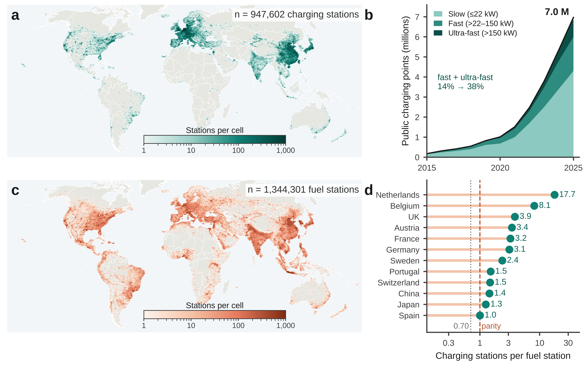

# Figure 1 · Global charging and fuel-refuelling infrastructure

Figure 1 establishes the geographic and numerical baseline for the two refuelling networks compared throughout the study. The inventories contain 947,602 charging stations and 1,344,301 fuel stations. Both count station sites. The IEA series in panel b counts individual public charging points (EVSE).



## Station inventories

Steps 01 and 02 write their local intermediate tables to `analysis/stage0_station_database/data/`. Steps 03 and 04 write the country-assigned inventories and GIS export to `shared/station_database/` by default.

| Step | Inputs | Processing and outputs |
|:--|:--|:--|
| [01 · Convert AMap coordinates](../../analysis/stage0_station_database/01_convert_amap_coordinates.py) | Licensed AMap charging-station CSV in GCJ-02 | Convert site coordinates to WGS84 and write the local `amap_stations_wgs84.parquet`. |
| [02 · Compile the two networks](../../analysis/stage0_station_database/02_merge_charging_networks.py) | Converted AMap records, licensed Google Places charging and fuel snapshots, Natural Earth country polygons | Retain AMap charging sites in mainland China and Google Places charging sites elsewhere. Write `charging_points_merged.parquet` and the separate Google Places fuel inventory, `fuel_points.parquet`. |
| [03 · Assign countries](../../analysis/stage0_station_database/03_assign_countries.py) | The two inventory tables and Natural Earth country polygons | Match sites by polygon intersection, then use the nearest polygon within 0.3° for unmatched sites. Write `charging_stations_with_country.parquet` and `fuel_stations_with_country.parquet` with country and ISO3 fields. |
| [04 · Export charging sites for GIS](../../analysis/stage0_station_database/04_export_geopackage.py) | Country-assigned charging inventory | Write the local WGS84 `charging_stations` layer in `charging_stations_merged.gpkg`. |
| [05 · Check the database](../../analysis/stage0_station_database/05_verify_database.py) | Country-assigned inventories and, when available, the Figure 1 country table | Print checks on station counts, charging-source totals, country assignment and the largest charging markets. |

## Workflow and formulas

| Step | Inputs | Processing and outputs |
|:--|:--|:--|
| [01 · Count sites](../../analysis/fig1_global_infrastructure/01_compute_statistics.py) | The two country-assigned inventories and the IEA country series for 2025 | Count sites, split charging sources and outer-join both networks by country. Write [national counts](data/country_stats.csv), the [global summary](data/global_summary.json) and the [six-market IEA cross-audit](../Supplementary_Figure1/data/crosscheck_stations_vs_iea.csv). Global counts include sites without a country assignment. |
| [03 · Verify the summary](../../analysis/fig1_global_infrastructure/03_verify_results.py) | The inventories, stored statistics, six-market audit and IEA world series by speed | Print checks on global counts and ratios, world charging-point growth and points per mapped station. |
| [Export figure data](../../export_figure_source_data.py) | Local station coordinates, aggregate statistics, IEA world series and Natural Earth boundaries | Project the two inventories to Robinson metres. Use the same map extent and `gridsize=440` for both. Export occupied cell centres and counts, a six-vertex template for [charging](data/hexagon_charging.json) and [fuel](data/hexagon_fuel.json), the supporting tables and a shared boundary layer. |
| [Draw the composite](make_Figure1.py) | Public hexagon tables and templates, world boundaries, global and national statistics, IEA annual world series | Draw the two log-colour density maps, the charging-point stock series and the country ranking as Figure 1a–d. |

For country $c$, the charging-to-fuel ratio is $N^{\mathrm{charging}}_c/N^{\mathrm{fuel}}_c$. The worldwide value is $947{,}602/1{,}344{,}301=0.70$ to two decimal places. The map extent contains 1,344,300 fuel sites. The inventory total includes the remaining site.

The IEA cross-audit uses a different denominator, $`\mathrm{points\ per\ station}_c=P^{\mathrm{IEA}}_{c,2025}/N^{\mathrm{charging}}_c`$. A mapped station may host several charging points. This comparison is plotted in [Supplementary Figure 1a](../Supplementary_Figure1/README.md).

## Panels and figure data

| Panel | Calculation or display | Public input |
|:--|:--|:--|
| a | Charging stations per hexagon, logarithmic colour scale | [Charging hexagons](data/hexbin_charging_stations.csv) |
| b | Global slow, fast and ultra-fast charging points, 2015–2025 | [IEA annual series](data/iea_world_by_speed.csv) |
| c | Fuel stations in the same projection and bins | [Fuel hexagons](data/hexbin_fuel_stations.csv) |
| d | Twelve highest charging-to-fuel ratios among countries with at least 3,000 fuel and 1,000 charging sites | [National counts](data/country_stats.csv) |

## Reproduce

Run from the repository root using the public figure data.

```bash
python figures/Figure1/make_Figure1.py
```

The [plotting script](make_Figure1.py) writes the composite as PNG, PDF, SVG and PDF-compatible Illustrator files in this folder.
