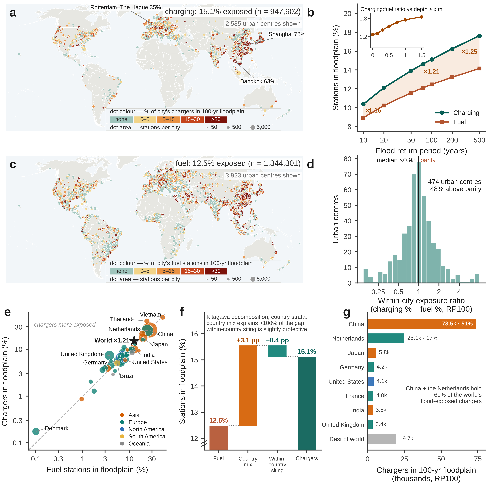
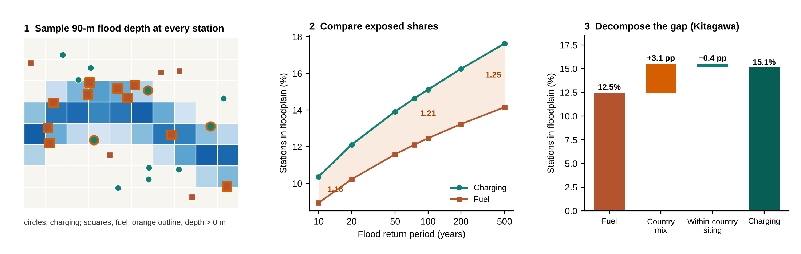

# Figure 2 · Direct flood exposure of charging and fuel networks

Figure 2 compares floodplain shares of charging and fuel stations. The fuel network is a road-service counterfactual because both networks follow settlements and roads. At the 100-year flood (RP100), 143,264 of 947,602 charging stations and 167,605 of 1,344,301 fuel stations lie in the floodplain.



## Flood sampling

| Step | Inputs | Processing and outputs |
|:--|:--|:--|
| [00 · Build the sampling index](../../analysis/fig2_flood_exposure/00_build_sampling_index.py) | Country-assigned charging and fuel coordinates, affine transform and dimensions of the JRC RP100 raster | Concatenate chargers first, then fuel stations. Convert coordinates to raster rows and columns, flag out-of-extent sites and group in-raster cells into 128 × 128 tiles. Local `sample_index.npz` stores the station permutation, sorted indices and tile offsets shared by all seven events. |
| [01 · Sample flood depths](../../analysis/fig2_flood_exposure/01_sample_flood_depths.py) | Sampling index and aligned JRC depth rasters for 10, 20, 50, 75, 100, 200 and 500 years | Read each occupied tile as a window, restore station order and merge four checkpointed parts into one `depth_RP*.npy` vector per return period. JRC dry-cell fill values at or above $10^{30}$ become zero. Out-of-extent records retain a missing depth. |
| [02 · Assemble the station table](../../analysis/fig2_flood_exposure/02_assemble_station_depths.py) | Station coordinates, country and charging source, plus the seven depth vectors | Write local `station_depths.parquet` in the same order, with network label (`ev` or `gas`) and columns `d010` through `d500`. |
| [03 · Assign urban centres](../../analysis/fig2_flood_exposure/03_assign_urban_centres.py) | Station coordinates from the depth table and 13,135 GHS-UCDB urban-centre polygons | Spatially match stations to urban centres in four batches. The local arrays `metro_p0.npy` through `metro_p3.npy` hold one UCDB ID per station, or −1 outside the centres. |



## Exposure metrics and Kitagawa decomposition

| Step | Inputs | Processing and outputs |
|:--|:--|:--|
| [04 · Compute core statistics](../../analysis/fig2_flood_exposure/04_compute_core_statistics.py) | Station depths, four urban-centre ID arrays and UCDB names | Write the [return-period series](data/rp_curve.csv), [RP100 depth-threshold series](data/depth_curve.csv), local `country_exposure.csv`, [paired urban-centre table](data/metro_ratios.csv) and [headline statistics](data/fig02_stats.json). |
| [05 · Assemble city summaries and decompose the gap](../../analysis/fig2_flood_exposure/05_compute_city_kitagawa.py) | RP100 station depths, urban IDs, UCDB names and centroids, Natural Earth country-to-continent mapping | Write the [charging-city map table](data/city_map_exposure.csv), city-ratio and continent tables, and the composition and siting terms. The exporter supplies the latter as [exposure_decomposition.json](data/exposure_decomposition.json). |
| [06 · Rank exposed stocks](../../analysis/fig2_flood_exposure/06_compute_stock_tables.py) | RP100 station depths, urban IDs, UCDB attributes, step 04 country table and Natural Earth continents | Write the [fuel-city map table](data/city_map_exposure_gas.csv), [country ranking by exposed charging stock](data/exposed_stock.csv) and [national exposure scatter](data/country_scatter.csv). |
| [08 · Verify results](../../analysis/fig2_flood_exposure/08_verify_results.py) | Local station depths and urban IDs, stored statistics and map tables | Recalculate global exposure, the ratio and its interval, the matched-country decomposition, paired-centre statistics, exposed-stock totals and city annotations. Print the check results. |
| [Independent tile resampling](../../analysis/fig2_flood_exposure/resample_public_jrc_tiles.py) (optional) | Local `station_depths.parquet` and original JRC depth tiles for a single return period | Resample the tiles at station locations. Report sites outside tile coverage, the exposed share and station-by-station agreement for each network, and the charging-to-fuel exposure ratio for both samplings. |
| [Export](../../export_figure_source_data.py) and [draw](make_Figure2.py) | Aggregate outputs from steps 04–06 and simplified world boundaries | Assemble the two maps, return-period and depth curves, urban distribution, national scatter, decomposition and exposed-stock ranking into Figure 2a–g. The city coordinates are UCDB centroids. |

For network $j$, let $n_j$ be the number of stations and $p_j$ the share with positive sampled depth. The global ratio is $R=p_c/p_f$, where $c$ denotes charging and $f$ denotes fuel. The 95% interval uses

$$
\mathrm{SE}(\log R)=\sqrt{\frac{1-p_c}{n_c p_c}+\frac{1-p_f}{n_f p_f}},
\qquad \mathrm{CI}_{95}=R\exp\!\left(\pm1.96\,\mathrm{SE}(\log R)\right).
$$

At RP100 the shares are 15.12% and 12.47%, giving $R=1.213$. For the threshold inset, the zero-threshold row requires depth **above** zero. Positive thresholds of 0.15, 0.30, 0.50, 0.75, 1.00 and 1.50 m include depths **at or above** the threshold. The urban comparison gives each eligible centre one ratio. Its median is 0.98 across 474 centres.

For the Kitagawa decomposition, retain country strata represented in both networks. Let $w_{jc}$ be country $c$’s share of network $j$ in this matched sample and $p_{jc}$ its floodplain share. With rates expressed as fractions, the two terms are

$$
\mathrm{composition}=\sum_c(w_{\mathrm{EV},c}-w_{\mathrm{fuel},c})\frac{p_{\mathrm{EV},c}+p_{\mathrm{fuel},c}}{2},\qquad
\mathrm{siting}=\sum_c(p_{\mathrm{EV},c}-p_{\mathrm{fuel},c})\frac{w_{\mathrm{EV},c}+w_{\mathrm{fuel},c}}{2}.
$$

In percentage points the matched-country gap is $3.07-0.43=2.64$. The global ratio above uses the full inventories.

## Panels and figure data

| Panel | Sample and statistic | Public input |
|:--|:--|:--|
| a, c | City floodplain share among centres with at least 20 sites of the network shown | [Charging](data/city_map_exposure.csv) · [Fuel](data/city_map_exposure_gas.csv) |
| b | Exposure by return period, with a depth-threshold inset | [Return periods](data/rp_curve.csv) · [Depth thresholds](data/depth_curve.csv) |
| d | Charging-to-fuel ratio in 474 centres with at least 50 stations and at least one exposed station of each type | [Paired centres](data/metro_ratios.csv) |
| e | National exposure shares in countries with at least 1,000 stations of each type | [Country comparison](data/country_scatter.csv) |
| f | Composition and siting contributions | [Decomposition](data/exposure_decomposition.json) |
| g | Country ranking by absolute number of exposed charging stations | [Exposed stock](data/exposed_stock.csv) |

## Reproduce

Run from the repository root using the public figure data.

```bash
python figures/Figure2/make_Figure2.py
```

The [plotting script](make_Figure2.py) writes the composite as PNG, PDF, SVG and PDF-compatible Illustrator files in this folder.
