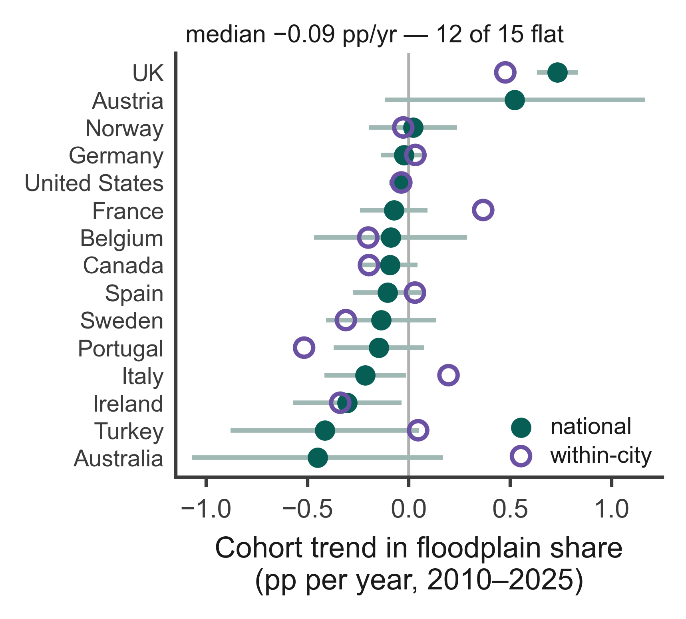

# Figure 3 · Flood exposure across charging-station opening cohorts

Figure 3 asks whether newer public chargers are drifting into or out of the 100-year river floodplain. Opening year is proxied by the Open Charge Map (OCM) registration year. Bulk imports can mix station ages within a calendar year, so the analysis applies country coverage gates before estimating trends. Fifteen countries with 218,560 dated stations pass the gates.



## Archive ingest, flood sampling and urban centres

| Step | Inputs | Processing and outputs |
|:--|:--|:--|
| [00 · Clean the archive and screen markets](../../analysis/fig3_opening_year_cohorts/00_ingest_ocm_archive.py) | Local OCM registry with location, country, registration year, status, operator and maximum power. Figure 2 `station_depths.parquet` supplies country and network for the coverage diagnostic. | Keep dated records in 2010–2025 with latitude −60° to 80° and longitude −180° to 180°. Drop planned and non-operational records and harmonise country names. Write local `archive_stations.parquet` and the [country coverage table](../Supplementary_Figure1/data/coverage_table.csv). |
| [01 · Sample archive depths](../../analysis/fig3_opening_year_cohorts/01_sample_flood_depths.py) | Archive coordinates and JRC rasters for 10, 20, 50, 75, 100, 200 and 500 years | Build the tile index, checkpoint depth samples by return period and assemble them in `archive_depths.parquet`. These samples refer to OCM sites. Figure 3 uses `d100`. |
| [02 · Assign urban centres](../../analysis/fig3_opening_year_cohorts/02_assign_urban_centres.py) | Archive coordinates and GHS-UCDB polygons | Query polygon intersections and write `archive_metro.npy` in archive row order. A value of −1 marks a site outside the urban centres. |

A country passes all three gates when it has at least 1,200 dated stations, at least six meaningful years and no more than 55% of registrations in its busiest year. A meaningful year contains at least $\max(30,0.01\,n)$ of the country's $n$ registrations. The script applies the 55% gate to the busiest-year share rounded to three decimal places. The separate `coverage_vs_merged` field divides dated OCM sites by Figure 2 charging sites in that country. It is reported for the inventory audit.

## Cohort statistics and city maps

| Step | Inputs | Processing and outputs |
|:--|:--|:--|
| [03 · Estimate cohort shares and slopes](../../analysis/fig3_opening_year_cohorts/03_compute_cohort_statistics.py) | Archive depths, registration years, countries, urban IDs and coverage flags. Figure 2 `country_exposure.csv` and `city_map_exposure.csv` supply the national benchmarks and city labels. | Keep countries that pass the gates. Write [cohort shares and Wilson limits](data/cohort_curves.csv), [national and within-city slopes](data/country_slopes.csv), [urban-centre slopes](data/metro_slopes.csv) and [summary statistics](data/cohort_stats.json). |
| [04 · Extract city maps](../../analysis/fig3_opening_year_cohorts/04_extract_city_maps.py) | Archive locations, years, depths and urban IDs, JRC RP100 raster, centre ID and window width | Extract Paris (2046, 28 km) and Málaga (1677, 24 km). Centre the window on flooded late-cohort sites when at least ten exist, then on all flooded sites when at least five exist, otherwise on all sites. Write local `citymap_<id>.npz` with the flood mask, station coordinates, cohort groups, exposure and city counts. |
| [07 · Leave one operator out](../../analysis/fig3_opening_year_cohorts/07_leave_one_operator_out.py) | Archive depths, years, operators and urban IDs, national and urban slope tables | Refit slopes after dropping each named operator with at least 20 sites in the unit. Write local `operator_robustness_countries.csv` for the retained markets and `operator_robustness_centres.csv` for centres with significant full-sample trends. The city table also gives the slope from 2019 onwards. |
| [06 · Verify results](../../analysis/fig3_opening_year_cohorts/06_verify_results.py) | Archive records, depths, urban IDs, coverage and trend tables, summary statistics and the two city extracts. The operator table is checked when present. | Print checks on market and sample sizes, slopes, significance counts and early/late city shares. |
| [Export](../../export_figure_source_data.py), [prepare backgrounds](../../analysis/map_backgrounds/01_build_map_backgrounds.py) and [draw](make_Figure3.py) | Four public aggregate files from step 03, two local city extracts, relief and street layers | Assemble the cohort and slope panels with the Paris and Málaga maps into Figure 3a–f. Station coordinates and the map extracts stay local. |

For each retained country, group stations into 2010–15, 2016–18, 2019–21, 2022–23 and 2024–25. A station is exposed when its RP100 depth is positive. In each cohort the table reports $100k/n$, where $k$ is the number exposed, with a 95% Wilson interval. Panel a plots cohorts with at least 30 observations at the midpoint of the registration window. Its dashed line is the country's **fuel-station** floodplain share from Figure 2.

National drift is estimated at station level from $I_i=\alpha+\beta\,\mathrm{year}_i+\varepsilon_i$, where $I_i$ indicates exposure. The reported trend is $100\beta$ percentage points per year, with HC1 robust standard errors. The median national trend is −0.09 percentage points per year. For the within-city estimate, demean both year and exposure by urban centre, using centres with at least 50 dated records. The fit requires at least 300 records across at least three such centres. Individual city trends require at least 200 dated stations and five distinct years.

The city maps distinguish early (through 2018) and late (2022–25) cohorts. Paris has early and late floodplain shares of 6.3% and 13.3%. In Málaga they are 46.2% and 18.5%, with only 13 stations in the early cohort.

## Panels and figure data

| Panel | Analysis | Inputs |
|:--|:--|:--|
| a | Five opening cohorts per country, with the national fuel-network benchmark | [Cohort shares](data/cohort_curves.csv) · [Country estimates](data/country_slopes.csv) |
| b | National and within-city slopes with 95% confidence intervals | [Country estimates](data/country_slopes.csv) |
| c | Distribution of trends across 80 urban centres | [City estimates](data/metro_slopes.csv) |
| d | Exposure of the 2024–25 cohort versus the national fuel benchmark | [Country estimates](data/country_slopes.csv) |
| e, f | Early (through 2018) and late (2022–25) cohorts over the Paris and Málaga floodplains | Local registration extracts, RP100 mask, terrain and street layers |

## Reproduce

Prepare the two local city extracts, relief and street layers using the [map-data instructions](../../RESTRICTED_DATA_NOTICE.md#using-locally-held-data). Run the composite from the repository root.

```bash
python figures/Figure3/make_Figure3.py
```

The [plotting script](make_Figure3.py) writes the composite as PNG, PDF, SVG and PDF-compatible Illustrator files in this folder.
