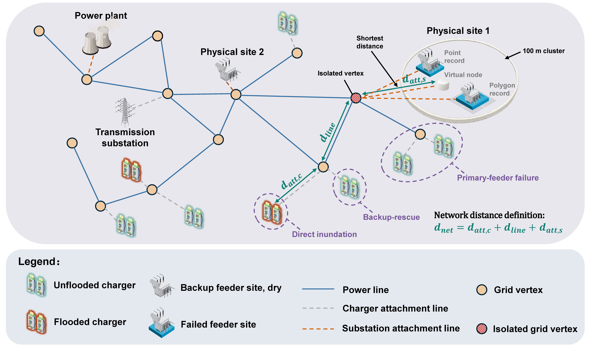
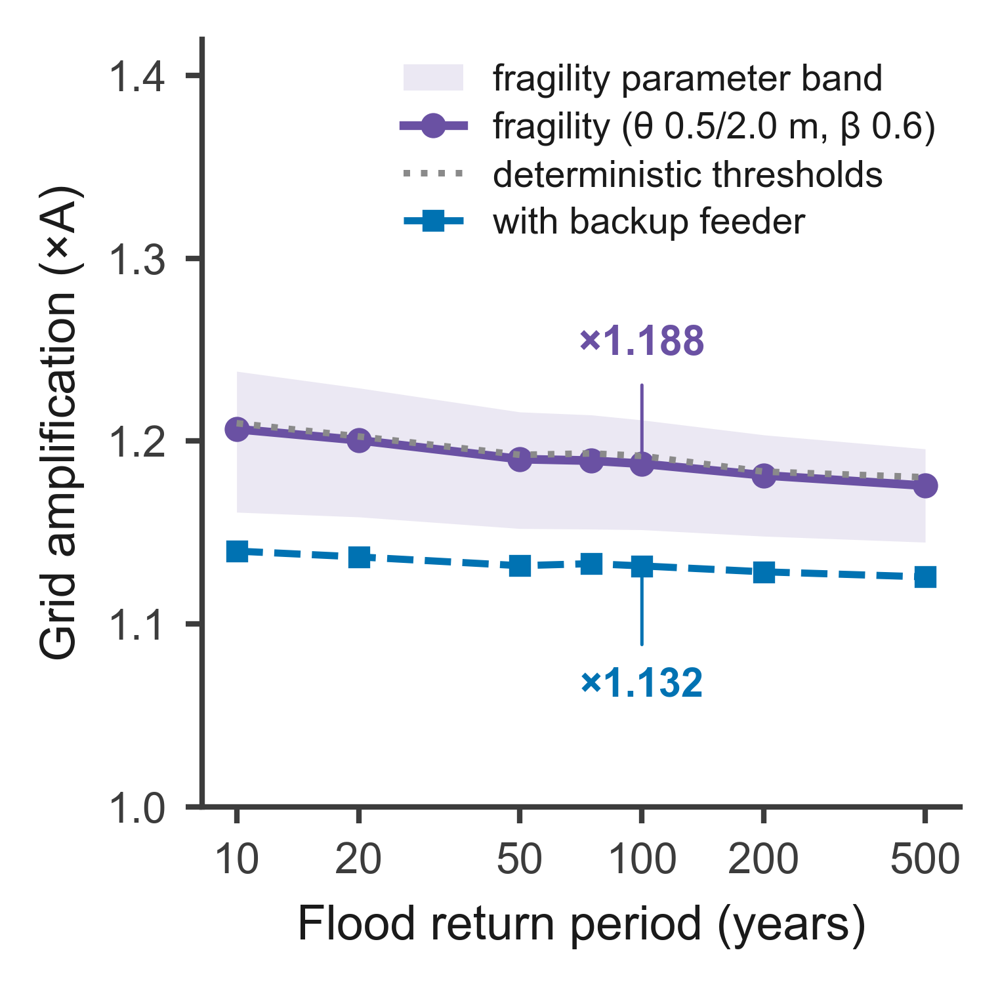

# Figure 4 · Grid-mediated amplification of charging disruption

A charging station can lose service while its own site stays dry if the substation that feeds it fails. At the 100-year river flood (RP100), **143,264** chargers flood directly. Including primary-feeder failure raises expected outages to **170,142**. Allowing a reachable backup feeder reduces that total to **162,131**. All three estimates use the same inventory and flood depths. [Global scenario table](data/cascade_rp_curve.csv)

[Assets and grid](#assets-and-grid) · [Feeder assignment](#step-06--physical-sites-and-feeder-assignment) · [Failure and backup](#step-07--fragility-and-backup-supply) · [Islanding](#step-08--islanding) · [Panels](#panels-and-figure-data) · [Running the analysis](#reproduce)

## Assets and grid

A *substation record* is a mapped OSM point or polygon. A *physical site* groups records that describe the same facility. A *feeder* in this model is the physical site assigned to a charger using the mapped grid. An *attachment vertex* is the point on the graph through which an asset connects.

The analysis reuses the charging-station rows of the Figure 2 depth table and their urban-centre assignments. It samples the JRC rasters separately at substations. The seven return periods are 10, 20, 50, 75, 100, 200 and 500 years. The files below are local analysis products except where a link leads to a public figure table. By default they reside in `analysis/fig4_grid_cascade/data/`, with the network arrays in `checkpoints/graph/`. [Provider inputs and path settings](../../DATA_SOURCES.md) · [Data access](../../RESTRICTED_DATA_NOTICE.md)

| Step | Inputs | Operation and outputs |
|:--|:--|:--|
| [00 · Extract power assets](../../analysis/fig4_grid_cascade/00_extract_power_nodes.py) | OSM power points and polygons, WRI Global Power Plant Database | Use point coordinates or polygon centroids for OSM substations. Read the maximum reported voltage, assign the class below and write `substations_global.parquet`. Combine OSM and WRI plant records in `plants_global.parquet`. |
| [01 · Sample substation depths](../../analysis/fig4_grid_cascade/01_sample_substation_depths.py) | Substation IDs and coordinates, seven JRC depth rasters | Sample each return period at each record. Per-period `subdepth_RP*.npy` checkpoints are assembled into `substation_depths.parquet`, keyed by `sub_id`. |
| [02 · Assign countries](../../analysis/fig4_grid_cascade/02_assign_substation_countries.py) | Substation IDs and coordinates, Natural Earth country boundaries | Write country and continent by `sub_id` to `substation_country.parquet`. These labels support the geographical summaries. |
| [03 · Find nearest substation records](../../analysis/fig4_grid_cascade/03_assign_chargers_to_substations.py) | Substation coordinates, Figure 2 `station_depths.parquet` filtered to chargers | A haversine BallTree finds the two nearest records by great-circle distance. `charger_assignment.parquet` stores `sub1`, `sub2`, `dist1_m` and `dist2_m` in charger order. Step 07 uses the first record for the distance fallback. |
| [04 · Build the line graph](../../analysis/fig4_grid_cascade/04_build_grid_graph.py) | The `grid` layer of the gridfinder GeoPackage, with gridfinder-predicted and OSM line features | Round coordinates to $10^{-6}$ degrees to identify shared vertices, split lines into segments and weight them by great-circle length. Write `vertices.npz` (position, component, degree), `segments.npz` (endpoints, length, feature ID) and `features.parquet` (source and feature summaries). |
| [05 · Attach assets](../../analysis/fig4_grid_cascade/05_attach_assets.py) | `vertices.npz`, the substation and plant inventories, Figure 2 charger coordinates | Find each asset’s nearest **graph vertex** on the unit sphere. Store its vertex ID and attachment distance in `attach_subs.npz`, `attach_plants.npz` or `attach_chargers.npz`. A distance above 10 km leaves the asset unattached (`vid = -1`). |

| Maximum reported voltage | OSM class used for backup matching |
|:--|:--|
| At least 110 kV | Transmission |
| 30 to less than 110 kV | Primary |
| 1 to less than 30 kV | Distribution |
| Below 1 kV | Low voltage |
| No usable voltage | Unknown |

## Step 06 · Physical sites and feeder assignment

1. **Cluster records into sites.** Join pairs of substation records within 100 m by union–find. Records joined through an intermediate record belong to the same site. The highest-voltage member supplies the representative record and its OSM class. A site is *major* for the fragility calculation if any member is transmission or primary.
2. **Contract the line graph.** Keep endpoints, junctions and every vertex with an attached substation, plant or charger. Replace an unoccupied degree-two chain by an edge whose weight is the sum of its segment lengths. For parallel edges with the same endpoints, keep the shortest weight.
3. **Give each attached site one connection.** Among the site’s attached members, choose the member with the shortest geometric attachment distance. Link a virtual node for the physical site to that member’s graph vertex. This is the site’s *canonical attachment*. The representative record supplies the voltage class, while the closest attached member supplies the connection. A multiply mapped facility therefore contributes only one feeder candidate.
4. **Find the two nearest distinct sites.** Multi-source Dijkstra gives the nearest site at every retained vertex, up to a graph search distance of 60 km. To find the second site, partition site ranks by each binary digit and search the half that excludes the nearest site. The minimum across those searches gives the nearest *different* physical site. This second result screens for the possibility of backup supply in step 07.
5. **Read the distances at each charger.** The service distance to candidate site $s$ is

```math
d_{\mathrm{net}}(i,s) = d_{\mathrm{att},i} + d_{\mathrm{line}}(v_i,v_s) + d_{\mathrm{att},s}.
```

Here $d_{\mathrm{att},i}$ is the great-circle distance from charger $i$ to its attachment vertex $v_i$. The middle term is the shortest line path from $v_i$ to the site’s canonical vertex $v_s$. The last term is the geometric connector from $v_s$ to the site. The 60 km graph search produces candidate labels. Step 07 applies the 10 km service limit to the full three-term distance. [Network assignment script](../../analysis/fig4_grid_cascade/06_network_feeders.py)



*Schematic 1. The orange dashed links illustrate the candidate member attachments. The shortest gives the physical site its connection to the grid. The callouts illustrate direct inundation, primary-feeder failure and a case with a dry, reachable backup.*

| Step 06 inputs | Step 06 outputs and their use |
|:--|:--|
| `substations_global.parquet` | `sub_sites.parquet` maps each `sub_id` to a physical `site_id`. `site_table.parquet` records each attached site's rank, representative, member count, major-site flag, canonical vertex and connector length. |
| `vertices.npz`, `segments.npz` and all three step 05 attachment arrays | `contracted.npz` stores the weighted graph and canonical connections. `node_feeders.npz` stores nearest and second distinct site labels and distances at retained vertices. `site_topology_audit.json` records attachment counts and distances. |
| Charger and plant attachment vertices and distances from step 05, together with the graph labels | `charger_network_assignment.parquet` gives `s1_rank`, `d1_net_m`, `s2_rank` and `d2_net_m` per charger. `plant_network_assignment.parquet` gives primary-site labels and distances per plant. |

## Step 07 · Fragility and backup supply

**Resolve the primary feeder.** Accept the closest network site when $d_{\mathrm{net}}\leq 10$ km. Otherwise, if the closest substation *record* from step 03 is within 8 km by great-circle distance, use the physical site containing that record. A charger outside both limits has zero modelled feeder loss and still contributes to direct flooding. Across the inventory, 90.13% of chargers use a network assignment, 4.57% use the fallback and 5.30% have neither.

**Convert depth to failure probability.** At each return period, take the maximum depth $d_s$ among a site's member records. Let $\Phi$ denote the standard normal cumulative distribution. The probability that site $s$ fails is

```math
p_s =
\begin{cases}
0, & d_s=0,\\[2pt]
\Phi\!\left(\dfrac{\ln(d_s/\theta_s)}{\beta}\right), & d_s>0 .
\end{cases}
```

The median failure depth $\theta_s$ is 2.0 m for major sites and 0.5 m for all other sites. The default log-depth dispersion $\beta$ is 0.6. The deterministic scenario uses $d_s\geq\theta_s$ as its failure threshold.

**Count direct and primary-feeder outages.** Let $I_i=1$ when the charger itself has positive flood depth and $I_i=0$ otherwise. Let $p_1$ be its primary feeder’s failure probability, taking $p_1=0$ for an unassigned charger. Direct inundation counts once, including when the feeder also fails.

```math
\begin{aligned}
P_i^{\mathrm{primary}} &= I_i+(1-I_i)p_1, \\[2pt]
N_{\mathrm{direct}}&=\sum_i I_i, \\[2pt]
A&=\frac{\sum_i P_i^{\mathrm{offline}}}{N_{\mathrm{direct}}}.
\end{aligned}
```

**Search for backup supply after primary failure.**

1. For a dry charger with a network primary, check whether any second distinct site could be reached within 10 km on the intact network. Removing connections can only eliminate paths or lengthen them. A charger that fails this screen retains its primary-only loss. The straight-line fallback supplies no network route for a backup search.
2. Isolate the primary site's canonical vertex and all its incident edges. Another site attached to that same vertex also loses access through it. If the charger's starting vertex is isolated, rerouting fails there.
3. From the charger's attachment vertex, search the residual graph for the **nearest reachable different site of the same OSM class**. All five classes in the table above are distinguished. The remaining search budget is $`10\,000-d_{\mathrm{att},i}`$ metres and includes the alternate site's connector. A nearer site of another class can therefore be passed over.
4. If an alternate is reachable, read its own failure probability $p_b$ at this return period. The model treats the two site failures as independent. Under the counterfactual the offline probability is

```math
P_i^{\mathrm{backup}} =
\begin{cases}
1, & I_i=1,\\[2pt]
p_1p_b, & I_i=0 \text{ and a compatible alternate is reachable},\\[2pt]
p_1, & I_i=0 \text{ and no compatible alternate is reachable}.
\end{cases}
```

At RP100, the primary-only model adds **26,878** expected outages above direct flooding ($A=1.188$). With backup supply, the increment is **18,867** ($A=1.132$). These are expectations summed over chargers. The residual search models the loss of one primary site at a time. Step 08 addresses simultaneous failures and the loss of connections to upstream supply. [Cascade script](../../analysis/fig4_grid_cascade/07_probabilistic_cascade.py) · [Routing implementation](../../analysis/fig4_grid_cascade/_joint_failure_routing.py)

| Step 07 calculation | Inputs | Outputs |
|:--|:--|:--|
| Primary assignment and site fragility | Steps 00–03 substation classes, depths and nearest-record table. Step 06 site membership, site table and charger assignments. Figure 2 charger depths | Local `assignment_stats.json` and `charger_cascade_rp100.parquet`. The latter carries individual station results. |
| Backup and sensitivity | Primary assignments and site depths, `contracted.npz` and `attach_chargers.npz` | Local `cascade_global.json` and routing diagnostics. The public [return-period table](data/cascade_rp_curve.csv) gives the primary, backup, threshold and sensitivity scenarios for all seven events. Sensitivity runs vary $\beta$ to 0.4 or 0.8, or scale $\theta_s$ by 0.75 or 1.5, one change at a time. |
| Spatial summaries | Charger-level direct and expected outages, station countries, step 02 country–continent labels, Figure 2 urban-centre IDs and names | [Country estimates](data/cascade_by_country.csv), [urban-centre estimates](data/cascade_metro_named.csv) and [global figure statistics](data/cascade_stats.json). The continent table is a local analysis output. Each group’s $A$ uses its own directly flooded count. A zero denominator yields a missing ratio. |

## Step 08 · Islanding

A charger can stay dry, retain its primary feeder and still lose upstream supply. The islanding diagnostic counts these additional losses under a deterministic RP100 event. [Islanding script](../../analysis/fig4_grid_cascade/08_islanding_check.py)

1. Compute RP100 site failure probabilities and flag sites with $p_s\geq0.5$. This is equivalent to the median-depth threshold. Isolate **all** failed attached sites’ canonical vertices and incident edges simultaneously on the contracted graph. Several failed sites may share a vertex.
2. Label connected components before and after isolation. Before the flood, a component is energised if it contains an attached plant or the attachment of a major site. After the flood, a component needs an attached plant or the attachment of a **surviving** major site. Plants are treated as available generation sources throughout this diagnostic.
3. Resolve each charger's primary feeder with the same 10 km network and 8 km fallback rules. Record direct inundation $I_i$ and deterministic failure of the assigned primary $F_i$. Set $F_i=0$ if there is no assigned feeder.
4. Evaluate energisation at **the charger's own attachment vertex**. Let $L_i^{\mathrm{pre}}$ and $L_i^{\mathrm{post}}$ indicate whether its component has a source before and after isolation. A charger with no network attachment cannot contribute an extra islanding loss. For an attached charger,

```math
J_i=(1-I_i)(1-F_i)L_i^{\mathrm{pre}}(1-L_i^{\mathrm{post}}).
```

5. Sum the deterministic service losses $N_{\mathrm{service}}=\sum_i \max(I_i,F_i)$, then add the newly islanded chargers. The same calculation is made for each country.

```math
\begin{aligned}
N_{\mathrm{conn}}&=N_{\mathrm{service}}+\sum_i J_i, \\[2pt]
\Delta A&=\frac{N_{\mathrm{conn}}-N_{\mathrm{service}}}{N_{\mathrm{direct}}}.
\end{aligned}
```

| Step 08 inputs | Outputs and RP100 checks |
|:--|:--|
| `contracted.npz`, `attach_plants.npz` and `attach_chargers.npz` | 41,860 failed attached sites map to 29,189 distinct failed vertices. The number of graph components rises from 9,360 to 125,297. |
| Substation classes and RP100 depths, site membership and site table, network and great-circle assignments, Figure 2 charger depths and countries | [Global islanding totals](../Supplementary_Figure2/data/islanding_global.json) and [country totals](../Supplementary_Figure2/data/islanding_country.csv). The deterministic service total rises from **170,758** to **186,132**, giving **15,374** additional losses and $\Delta A=0.1073$. |

## City extracts, GIS export and checks

| Step | Inputs | Outputs |
|:--|:--|:--|
| [09 · Extract city networks](../../analysis/fig4_grid_cascade/09_extract_city_vignettes.py) | City ID and window width, Figure 2 station depths and urban IDs, station and plant records, feeder assignments, RP100 charger results, local network geometry and flood raster or prepared geometry cache | A local extract for each city with charger states, feeder sites, primary and rescue paths, flood mask and line geometry. The figure-data exporter stages these as `data/private/feeder_map_<id>.npz`. |
| [11 · Export model for GIS](../../analysis/fig4_grid_cascade/11_export_grid_model.py) | Grid lines, graph features and attachments, asset and assignment tables, site depths, assignment statistics and the four city windows | `gis/grid_model_global.gpkg` and `gis/grid_model_light.gpkg`. The second covers the four windows. Both contain station-level geometry and stay local. |
| [12 · Verify results](../../analysis/fig4_grid_cascade/12_verify_results.py) | Topology audit and contracted graph, local station depths and assignments, cascade and islanding results, routing diagnostics and four city extracts | Printed checks of graph structure, RP100 totals and routing. A failed check exits with an error. |
| [13 · Test failure routing](../../analysis/fig4_grid_cascade/13_test_site_failure_topology.py) | Synthetic radial and meshed graphs defined in the script | Assertions for blocked paths, rerouting and compatible alternates. Runs independently of the study data. |

## Panels and figure data

| Panel | What is plotted | Figure inputs |
|:--|:--|:--|
| a–d | Düsseldorf (ID 2288, 12 km), Tainan (12703, 15.5 km), Handan (10912, 18 km) and Québec City (1048, 13 km). These are the four highest-amplification centres among those with at least 200 chargers and 20 directly flooded. The runner passes their IDs and window widths to step 09. | Local feeder extracts, terrain and background maps. The labels distinguish direct flooding, feeder loss and backup rescue. |
| e | Urban amplification for centres with at least 100 chargers and 20 directly flooded. Each point marks the urban-centre centroid. | [City summaries](data/cascade_metro_named.csv) · [Public centroids](data/urban_centre_coordinates.csv) |
| f | Global amplification across seven return periods, including the threshold scenario, fragility sensitivity envelope and backup counterfactual. | [Scenario curves](data/cascade_rp_curve.csv) |
| g | National amplification versus directly flooded share for countries with at least 1,000 chargers and 100 directly flooded. The correlation uses the log of the directly flooded percentage. | [Countries](data/cascade_by_country.csv) · [Correlation](data/cascade_stats.json) |
| h | Primary and backup amplification for the ten eligible countries with the largest **absolute grid-added losses**, using the same inclusion thresholds as g. | [Countries](data/cascade_by_country.csv) |
| i | Grid-added losses in the eight countries with the largest such losses and a residual for the rest of the world. | [Countries](data/cascade_by_country.csv) · [Global total](data/cascade_stats.json) |



## Reproduce

Prepare the local feeder extracts and map backgrounds for Düsseldorf, Tainan, Handan and Québec City using the [map-data instructions](../../RESTRICTED_DATA_NOTICE.md#using-locally-held-data). Run the following command from the repository root.

```bash
python figures/Figure4/make_Figure4.py
```

The plotting script writes `Figure4.png`, `Figure4.pdf`, `Figure4.svg` and `Figure4.ai` beside the script. The feeder extracts and rendered point maps stay local. [Map input requirements](../../RESTRICTED_DATA_NOTICE.md#using-locally-held-data) · [Supplementary Figure 2](../Supplementary_Figure2/README.md)
