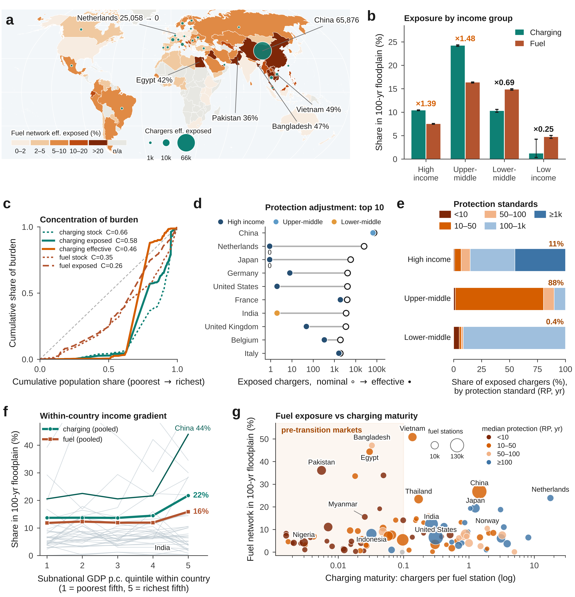

# Figure 5 · Income gradients and flood-protection adjustment

Who carries charging flood exposure, and how do protection standards change nominal exposure into effective exposure? Of the 143,264 chargers within the 100-year floodplain, 79,908 have a local protection standard below that event. Upper-middle-income countries account for 88.4% of effectively exposed chargers.



## Covariates

| Step | Inputs | Processing and outputs |
|:--|:--|:--|
| [00 · Obtain source covariates](../../analysis/fig5_inequality_protection/00_download_source_data.py) | Provider locations for World Bank income classes, Kummu GDP, FLOPROS and OWID population | This optional download step stores the source files in the local input tree and extracts the FLOPROS polygons. The national WDI GDP and population exports and GDP metadata are supplied separately. [Input sources](../../DATA_SOURCES.md) |
| [01 · Join national attributes](../../analysis/fig5_inequality_protection/01_build_station_covariates.py) | Figure 2 station depths, country/ISO3 fields from the two inventories, World Bank income classes, WDI GDP and population, Kummu national GDP and OWID population | Attach income class, national GDP per capita and population by ISO3. Prefer 2025 WDI, then 2024. Fill missing GDP with Kummu 2024 where available and missing Taiwan population with OWID 2023. Store the base table in `checkpoints/ck_base.parquet` and record coverage in `build_log.json`. |
| [01 · Sample local GDP and protection](../../analysis/fig5_inequality_protection/01_build_station_covariates.py) | Base table, Kummu 2024 admin-2 GDP (5 arc minutes) and FLOPROS merged river standard (2.5 arc minutes) | Rasterise `MerL_Riv` from FLOPROS polygons when the local raster is missing. Sample both rasters at the stations. Fill missing admin-2 GDP from national GDP and missing protection from the median of available station values in the same ISO3 group. Write local `fig05_station_covariates.parquet` and update the build log. |

## Exposure and protection

For an event of return period $T$, let $d_{i,T}$ be flood depth and $s_i$ the local protection standard in years. Nominal exposure is $\mathbf{1}[d_{i,T}>0]$. Effective exposure is $\mathbf{1}[d_{i,T}>0]\mathbf{1}[s_i<T]$. A standard equal to the event return period therefore counts as adequate protection in this calculation.

The [statistics script](../../analysis/fig5_inequality_protection/02_compute_statistics.py) reads the station covariate table once. Its outputs serve Figure 5 and [Supplementary Figure 3](../Supplementary_Figure3/README.md).

| Step 02 calculation | Input fields and selection | Outputs |
|:--|:--|:--|
| Check direct exposure and summarise by income | Station network, RP100 depth and World Bank income class | Check the charging and fuel counts against Figure 2. Write local `qa_fig02_check.json` and [income-group exposure shares with Wilson intervals](data/income_group_exposure.csv). |
| Concentration across countries | Country stock and exposure totals, national GDP per capita and population. Keep countries with both economic fields and order by increasing GDP per capita. | [Cumulative population, station stock and burden shares](data/concentration_curve.csv) and [concentration indices](data/concentration_indices.json). For cumulative burden $y$ and cumulative population $x$, $C=1-2\int_0^1 y(x)\,dx$, evaluated by the trapezoidal rule. |
| Protection adjustment | Direct exposure, local protection standard, income class and country. Rank countries by nominally exposed charger count. | [Protection by income](data/protection_by_income.csv), [the 15 largest nominally exposed markets](data/protection_by_country.csv), [protection-standard bins among exposed chargers](data/protection_bins_income.csv) and [event-magnitude sensitivity](../Supplementary_Figure3/data/protection_sensitivity.json). |
| Within-country quintiles | Station exposure and admin-2 GDP. The country-specific charging analysis requires at least 2,000 chargers and eight distinct GDP values. For the pooled curves, apply these criteria separately within each country and network. | Rank station GDP within each eligible group, break ties in row order and split into five equal-frequency groups. Write [charging-country quintiles](data/quintile_within_country.csv), [pooled charging and fuel estimates](data/quintile_pooled.csv) and local `quintile_slopes.csv`. |
| Transition inheritance | Country charging and fuel stock, fuel exposure and protection. Retain countries with at least 1,000 fuel sites. | [Country indicators](data/inheritance_country.csv), a local summary by maturity group (`inheritance_bins.csv`) and [headline statistics](data/fig05_stats.json). Maturity is $N_{\mathrm{charging}}/N_{\mathrm{fuel}}$. Values below 0.1 identify pre-transition markets. |

[Step 04](../../analysis/fig5_inequality_protection/04_verify_results.py) reads the station covariates, summary statistics, concentration indices and pooled quintiles. It checks counts, protection, population shares, concentration and gradients, and verifies that the nine aggregate inputs read by the composite exist and contain data. The [figure-data exporter](../../export_figure_source_data.py) supplies the aggregate tables for the composite.

## Panels and figure data

| Panel | Calculation | Public input |
|:--|:--|:--|
| a | Country colour shows effective fuel exposure. Symbols mark countries with more than 100 effectively exposed chargers. | [Fuel exposure](data/inheritance_country.csv) · [Charger counts](data/concentration_curve.csv) · [Map annotations](data/protection_by_country.csv) |
| b | Exposure by World Bank income group, with Wilson intervals | [Income groups](data/income_group_exposure.csv) |
| c | Cumulative population, stock and exposure ordered by GDP per capita | [Curves](data/concentration_curve.csv) · [Indices](data/concentration_indices.json) |
| d, e | Nominal versus effective counts in the ten largest exposed markets, and protection standards by income | [Country totals](data/protection_by_country.csv) · [Protection bins](data/protection_bins_income.csv) |
| f | Exposure across within-country GDP quintiles | [National quintiles](data/quintile_within_country.csv) · [Pooled estimates](data/quintile_pooled.csv) |
| g | Fuel-network exposure versus charging maturity. Pre-transition markets have fewer than 0.1 charging stations per fuel station and at least 1,000 fuel stations | [Country indicators](data/inheritance_country.csv) |

## Reproduce

Run from the repository root using the public figure data.

```bash
python figures/Figure5/make_Figure5.py
```

The [plotting script](make_Figure5.py) writes the composite as PNG, PDF, SVG and PDF-compatible Illustrator files in this folder.
