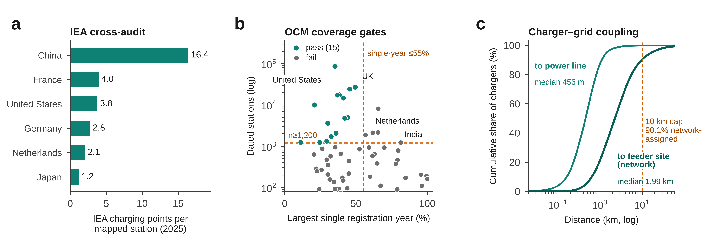

# Supplementary Figure 1 · Input-database quality audits

Three diagnostics support the main analysis. They examine inventory coverage, cohort suitability and charger–grid coupling. The composite uses five public aggregate files.



## Panel a · IEA cross-audit

**Inputs.** The [Figure 1 statistics script](../../analysis/fig1_global_infrastructure/01_compute_statistics.py) reads the mapped charging inventory and IEA public charging-point counts for 2025. It sums IEA counts by market across speed classes.

**Calculation and output.** Divide each country's IEA points by its mapped station sites. Store the numerator, denominator and ratio in the [six-market cross-audit](data/crosscheck_stations_vs_iea.csv). The plotting script orders the six markets by ratio. China has about 16.4 points per mapped station and Japan about 1.2. A site may host several points, so the ratio reflects station configuration as well as inventory coverage.

$$
\mathrm{points\ per\ mapped\ station}_c
=\frac{P^{\mathrm{IEA}}_{c,2025}}{N^{\mathrm{charging}}_c}.
$$

## Panel b · OCM coverage gates

**Inputs.** The [Figure 3 archive ingest](../../analysis/fig3_opening_year_cohorts/00_ingest_ocm_archive.py) reads dated OCM records and, for the separate coverage diagnostic, Figure 2 station counts by country.

**Calculation and output.** For each country, count its dated stations, the years with meaningful additions and the busiest year's share of all records. The [coverage table](data/coverage_table.csv) records the three quantities and the `qa_pass` flag. The scatter plots sample size against the busiest-year share. Its colour uses all three gates.

| Gate | Criterion |
|:--|:--|
| Dated stations | At least 1,200 |
| Meaningful years | At least six years, each with at least the larger of 30 records and 1% of the country's dated records |
| Maximum single-year share | At most 55%, applied to the stored share rounded to three decimals |

The passing sample comprises 15 markets and 218,560 dated stations.

## Panel c · Charger-to-grid coupling

**Inputs.** The [asset attachment](../../analysis/fig4_grid_cascade/05_attach_assets.py) and [network feeder assignment](../../analysis/fig4_grid_cascade/06_network_feeders.py) supply two fields in local `charger_network_assignment.parquet`. The first, `attach_dist_m`, is the great-circle distance to the nearest grid vertex. The second, `d1_net_m`, includes the charger connector, the shortest line path and the feeder site's connector.

**Calculation and outputs.** For each distance, the [figure-data exporter](../../export_figure_source_data.py) sorts finite values, converts metres to kilometres and divides the cumulative count by **all 947,602 chargers**. It exports up to 4,000 order statistics for the [attachment curve](data/cdf_charger_to_power_line.csv) and [feeder-distance curve](data/cdf_charger_to_feeder_site.csv). The [coupling summary](data/coupling_summary.json) supplies three annotations.

| Quantity | Population used | Value |
|:--|:--|--:|
| Median distance to nearest mapped line vertex | Chargers with a recorded nearest-vertex distance, including distances above the attachment cap | 456 m |
| Median network distance to primary feeder | Chargers with a network distance at or below 10 km | 1.99 km |
| Network-assigned share at the 10 km service limit | All chargers in the denominator | 90.1% |

The composite plots both curves against log distance and marks the 10 km limit. Only cumulative shares and summary distances are needed for drawing.

## Reproduce

Run from the repository root using the public figure data.

```bash
python figures/Supplementary_Figure1/make_Supplementary_Figure1.py
```

The [plotting script](make_Supplementary_Figure1.py) writes the composite as PNG, PDF, SVG and PDF-compatible Illustrator files in this folder.
