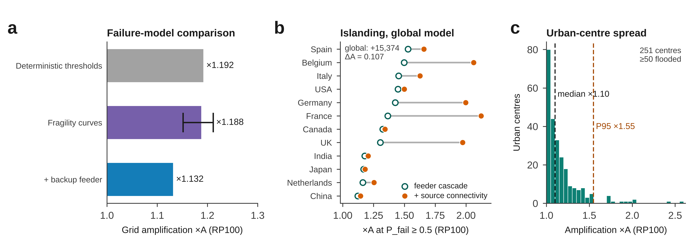

# Supplementary Figure 2 · Robustness of the grid-cascade model

How sensitive are charging outages to the substation failure rule, the availability of a backup feeder and the loss of a path to generation? All three panels use the 100-year flood (RP100). Panels a and b use global or national totals. Panel c gives each eligible urban centre one observation. [Figure 4 methods and input files](../Figure4/README.md)



## Panel a · Feeder failure and backup

**Input.** The RP100 row of the [Figure 4 scenario table](../Figure4/data/cascade_rp_curve.csv). The denominator in each scenario is the same 143,264 directly flooded chargers. Amplification is expected offline chargers divided by that count.

| Scenario | Calculation | Field | RP100 amplification |
|:--|:--|:--|--:|
| Deterministic thresholds | A feeder site fails at or above its class-specific median depth (2.0 m for major sites, 0.5 m otherwise). Count directly flooded chargers and dry chargers whose primary feeder fails. | `A_threshold` | 1.192 |
| Primary feeder with fragility | Use the lognormal site-failure probability with dispersion 0.6. Sum the failure probabilities of dry chargers’ primary feeders and add directly flooded chargers. | `A_fragility` | 1.188 |
| Reachable backup | Isolate the primary attachment and search for a different site of the same voltage class on the residual graph. For a dry charger with an eligible alternate, multiply the two feeder-failure probabilities. | `A_redundant` | 1.132 |

**Output.** Three scenario estimates. The line on the primary-feeder estimate shows parameter sensitivity. Vary dispersion $\beta$ to 0.4 or 0.8 at the default median depths, or multiply both median depths by 0.75 (softer) or 1.5 (harder) at the default dispersion. The plotted bounds are

$$
A_{\min}=\min(A_{\mathrm{hard}},A_{\beta=0.4},A_{\beta=0.8}),\qquad
A_{\max}=\max(A_{\mathrm{soft}},A_{\beta=0.4},A_{\beta=0.8}).
$$

The RP100 range is **1.151–1.212**. Its endpoints are sensitivity runs. [Failure probabilities and residual-network search](../Figure4/README.md#step-07--fragility-and-backup-supply)

## Panel b · Source-connected islanding

**Inputs.** [Country totals](data/islanding_country.csv) provide charger count (`n`), direct flooding (`direct`), deterministic service losses (`svc`) and losses after the source-connectivity test (`conn`). [Global totals](data/islanding_global.json) provide the annotation.

1. Fail every site with $p_s\geq0.5$ and isolate the canonical attachment vertices of all failed attached sites simultaneously. Recompute connected components. An attached plant or surviving major substation supplies its post-flood component.
2. Count an additional loss at a charger's attachment vertex only if the component had a source before the cuts and has none afterwards, the charger is dry and its primary feeder has not already failed. This counts each charger once.
3. For each country with at least 1,000 chargers and 100 directly flooded, calculate $A_{\mathrm{service}}=N_{\mathrm{service}}/N_{\mathrm{direct}}$ and $A_{\mathrm{conn}}=N_{\mathrm{conn}}/N_{\mathrm{direct}}$. Select the 12 largest eligible inventories by `n` and order the displayed pairs by `A_service`.

**Output.** The two points per country give the deterministic feeder-only and feeder-plus-islanding amplification. The annotation uses the full global inventory. Globally the outage count rises from **170,758** to **186,132**. Both are deterministic counts.

$$
\Delta A=\frac{N_{\mathrm{conn}}-N_{\mathrm{service}}}{N_{\mathrm{direct}}}
=\frac{15{,}374}{143{,}264}=0.1073 .
$$

The source-connectivity test and its graph inputs are documented in [Figure 4, step 08](../Figure4/README.md#step-08--islanding).

## Panel c · Urban amplification

**Input.** The [Figure 4 urban-centre table](../Figure4/data/cascade_metro_named.csv) supplies the directly flooded count (`direct`), expected primary-only losses (`total`) and their ratio (`A_total`) for each centre.

$$
A_{\mathrm{city}}=\frac{E_{\mathrm{offline,city}}}{N_{\mathrm{direct,city}}}.
$$

**Output.** Retain centres with at least 50 directly flooded chargers and a defined ratio. Across **251** centres, the unweighted median is **1.1005** and the 95th percentile is **1.5473**. For display, values above 2.6 are placed at 2.6 and the histogram uses 0.05-wide bins. The two percentile lines are calculated from the original ratios before clipping. Figure 4e uses a separate inclusion rule for its map.

## Reproduce

Run the composite from the repository root. The four aggregate input files linked above are sufficient.

```bash
python figures/Supplementary_Figure2/make_Supplementary_Figure2.py
```

The script writes `Supplementary_Figure2.png`, `Supplementary_Figure2.pdf`, `Supplementary_Figure2.svg` and `Supplementary_Figure2.ai` beside the [plotting script](make_Supplementary_Figure2.py).
