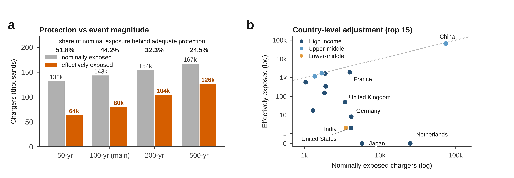

# Supplementary Figure 3 · Robustness of protection adjustment

This figure examines event-magnitude sensitivity and the country-level distribution of nominal and effective exposure from Figure 5. Panel a varies the event return period. Panel b holds the event at RP100 and compares countries.



## Inputs and processing

| Step | Inputs | Processing and outputs |
|:--|:--|:--|
| [Attach protection standards](../../analysis/fig5_inequality_protection/01_build_station_covariates.py) | Local Figure 2 station-depth records, FLOPROS river standards and the country and income attributes used in Figure 5 | Write `fig05_station_covariates.parquet` with station network, depths, country, income group and local protection standard (`prot_rp`). This station-level table stays local. |
| [Summarise the four events](../../analysis/fig5_inequality_protection/02_compute_statistics.py) | Charging rows, `d050`, `d100`, `d200`, `d500` and `prot_rp` | For each return period, count nominally and effectively exposed chargers and the share behind adequate protection. Write the four event records in [protection_sensitivity.json](data/protection_sensitivity.json). |
| [Summarise countries at RP100](../../analysis/fig5_inequality_protection/02_compute_statistics.py) | Charging rows, `d100`, `prot_rp`, ISO3 and income group | Rank countries by nominally exposed charger count. For the top 15, write nominal and effective counts and income class to [the Figure 5 country table](../Figure5/data/protection_by_country.csv). |
| [Draw the composite](make_Supplementary_Figure3.py) | The four event records and 15 country rows | Draw the paired global bars and the country scatter from these two public files. |

## Panel a · Event-magnitude sensitivity

For event $T$, $d_{i,T}$ is the sampled depth at charger $i$, and $s_i$ is its local protection standard in years. Each event uses its own depth column.

$$
N_{\mathrm{nominal},T}=\sum_i \mathbf{1}[d_{i,T}>0],\qquad
N_{\mathrm{effective},T}=\sum_i \mathbf{1}[d_{i,T}>0]\,\mathbf{1}[s_i<T].
$$

The protected share printed above each pair of bars is $100(1-N_{\mathrm{effective},T}/N_{\mathrm{nominal},T})$.

| Return period | Nominally exposed | Effectively exposed | Protected share |
|--:|--:|--:|--:|
| 50 years | 131,899 | 63,543 | 51.8% |
| 100 years | 143,264 | 79,908 | 44.2% |
| 200 years | 154,014 | 104,224 | 32.3% |
| 500 years | 167,089 | 126,177 | 24.5% |

## Panel b · Country-level nominal and effective exposure

Each point is one of the 15 largest nominally exposed charging markets. Its horizontal coordinate is the nominal count, its vertical coordinate is the effective count and its colour denotes World Bank income group. The diagonal marks equality. A country with zero effectively exposed chargers is plotted at 0.3 for visibility on the logarithmic axis. The country table retains the zero count.

## Reproduce

Run from the repository root using the public figure data.

```bash
python figures/Supplementary_Figure3/make_Supplementary_Figure3.py
```

The [plotting script](make_Supplementary_Figure3.py) writes the composite as PNG, PDF, SVG and PDF-compatible Illustrator files in this folder.
