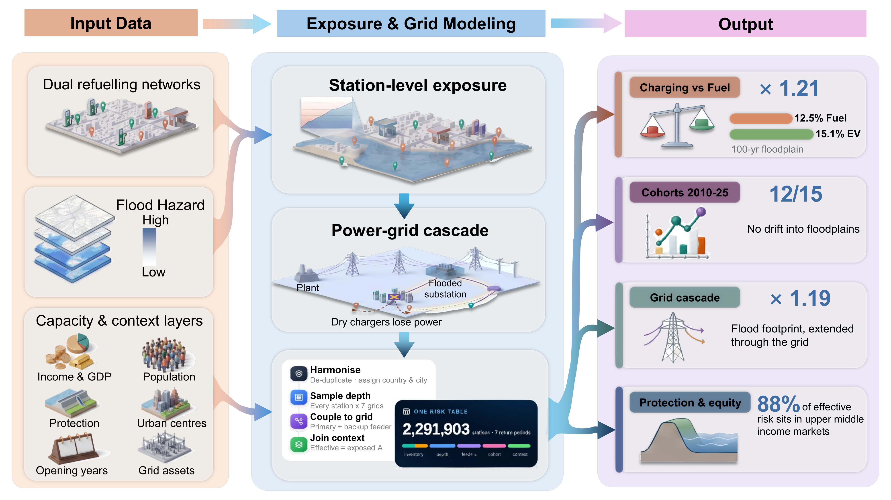

# Supplementary Figure 4 · Study workflow

The schematic follows the charging and fuel networks from input inventories through station-level exposure and power-grid modelling to the four results shown on the right.

## Inputs and outputs in the schematic

| Analysis stage | Inputs | Outputs carried into the schematic |
|:--|:--|:--|
| [Assemble the refuelling networks](../Figure1/README.md) | Google Places charging and fuel inventories, AMap charging sites for mainland China, Natural Earth boundaries | Two country-assigned inventories with 947,602 charging sites and 1,344,301 fuel sites, giving 2,291,903 station records for depth sampling. |
| [Sample river-flood exposure](../Figure2/README.md) | Both inventories, seven JRC depth rasters, GHS-UCDB urban centres | Local station depths and urban IDs. At RP100, charging and fuel floodplain shares are 15.1% and 12.5% respectively, a charging-to-fuel ratio of 1.21. |
| [Compare registration cohorts](../Figure3/README.md) | A separate OCM archive of dated sites, JRC RP100 depths sampled at those sites, urban IDs and national fuel benchmarks | National and within-city trends. Of 15 eligible countries, 12 have a national trend whose 95% interval includes zero, two have negative trends and one has a positive trend with intervals excluding zero. |
| [Couple chargers to the power grid](../Figure4/README.md) | Charger depths, mapped lines, physical substation sites, site depths and network feeder assignments | Expected primary-feeder outages divided by directly flooded chargers give the RP100 amplification of 1.19. [Supplementary Figure 2](../Supplementary_Figure2/README.md) gives the backup and islanding diagnostics. |
| [Apply protection and income attributes](../Figure5/README.md) | Station depths, local FLOPROS protection standards, income classes, GDP and population | Nominal and effective counts by income class. Upper-middle-income countries account for 88.4% of effectively exposed chargers at RP100, rounded to 88% in the schematic. |

The [PNG](Supplementary_Figure4.png) is the complete figure supplied with the repository. The linked analysis guides give the calculations behind its labels.
